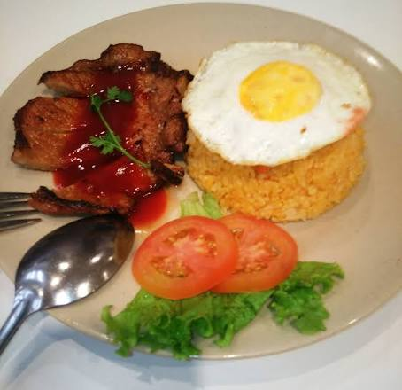
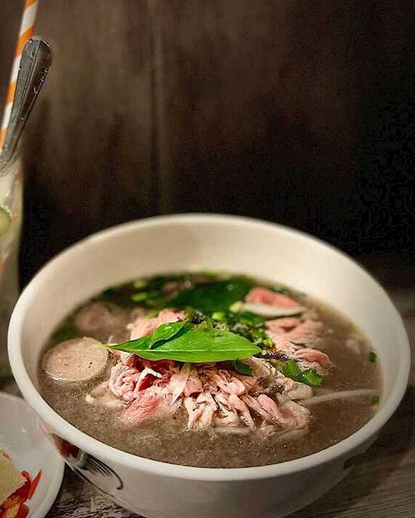
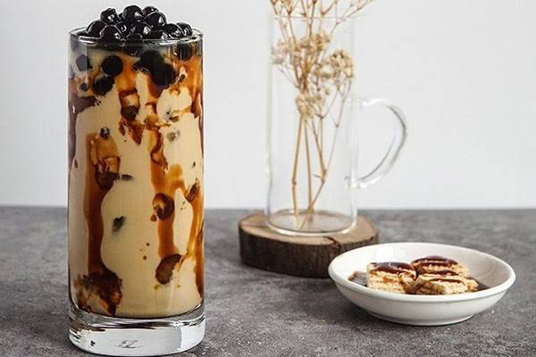

# Scrum – Campus Food Express

## (a) Bảng phân vai trò
| Vai trò Scrum | Người đảm nhiệm | Trách nhiệm |
|---------------|-----------------|-------------|
| Product Owner | HongQuan | Quản lý Product Backlog, quyết định thứ tự ưu tiên |
| Scrum Master | HongQuan | Duy trì quy trình Scrum, gỡ vướng mắc |
| Development Team | HongQuan | Backend, Frontend, kiểm thử, triển khai |

Nhóm hiện chỉ có 1 thành viên nên kiêm nhiệm cả ba vai trò; khi có thêm người sẽ tách Product Owner / Scrum Master.

## (b) Backlog Sprint 0
**Mục tiêu Sprint 0 (2026-11-15 → 2026-11-21):** dựng nền tảng kỹ thuật và quy trình để Sprint 1 có thể phát triển tính năng ngay.

| # | Hạng mục (user story / task) | Ưu tiên | Ước lượng (giờ) | Trạng thái |
|---|------------------------------|---------|-----------------|------------|
| 1 | Chốt đề tài, Project Charter | Cao | 3 | Xong |
| 2 | Lập WBS + Gantt | Cao | 3 | Xong |
| 3 | Tạo repo, quy trình nhánh + PR | Cao | 2 | Xong |
| 4 | Thiết lập CI (GitHub Actions) | Cao | 3 | Xong |
| 5 | Thiết kế CSDL + nạp dữ liệu mẫu (SQL dump) | Cao | 4 | Xong |
| 6 | Dựng môi trường chạy thử trên VPS | Trung bình | 4 | Đang làm |
| 7 | Unit test cho service hiện có | Cao | 4 | Xong |
| 8 | Phác thảo giao diện (menu, giỏ hàng, lịch sử đơn) | Trung bình | 3 | Xong |
| 9 | Risk register + kế hoạch chất lượng | Trung bình | 3 | Đang làm |
| 10 | Chuyển mật khẩu DB sang biến môi trường | Cao | 1 | Chưa làm |

### Backlog MVP dự kiến cho Sprint 1
- Là sinh viên, tôi muốn đăng ký/đăng nhập để lưu thông tin và lịch sử đơn.
- Là sinh viên, tôi muốn xem, tìm kiếm, lọc theo danh mục và sắp xếp món theo giá.
- Là sinh viên, tôi muốn thêm món vào giỏ và đặt hàng với địa điểm nhận + ghi chú.
- Là sinh viên, tôi muốn nhập mã giảm giá (vd. SV2026 giảm 10%).
- Là sinh viên, tôi muốn hủy đơn khi còn ở trạng thái "Đang xử lý".

## (c) Demo ý tưởng / MVP ban đầu
Bản chạy thử đơn giản đã có sẵn trong repo (frontend tĩnh trong `src/main/resources/static`):
- Trang đăng nhập: `login.html`, đăng ký: `register.html`
- Trang menu + giỏ hàng: `index.html`
- Lịch sử đơn: `order-history.html`

Cách chạy: `./mvnw spring-boot:run` rồi mở http://localhost:8080/

Ảnh món ăn minh họa:

| | | |
|---|---|---|
|  |  |  |

> Bổ sung ảnh chụp màn hình thực tế vào `docs/img/` trước buổi demo và liên kết tại đây.
