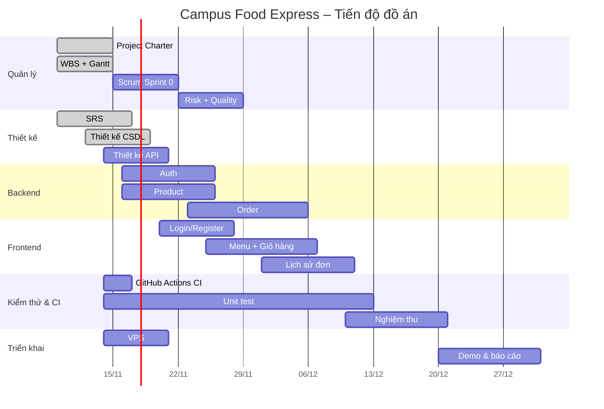

# WBS & Gantt – Campus Food Express

## 1. WBS (cấu trúc phân rã công việc)
```
1. Quản lý dự án
   1.1 Project Charter
   1.2 WBS + Gantt
   1.3 Scrum: backlog, sprint planning, review
   1.4 Risk register + kế hoạch chất lượng
2. Phân tích & thiết kế
   2.1 Thu thập yêu cầu (SRS)
   2.2 Thiết kế CSDL (users, categories, products, orders, order_items, coupons)
   2.3 Thiết kế API REST
   2.4 Thiết kế giao diện (login, trang chủ, lịch sử đơn)
3. Phát triển Backend (Spring Boot)
   3.1 Xác thực: đăng ký / đăng nhập
   3.2 Sản phẩm: danh mục, tìm kiếm, lọc, sắp xếp
   3.3 Đơn hàng: tạo đơn, mã giảm giá, hủy đơn, lịch sử
4. Phát triển Frontend
   4.1 Trang đăng ký / đăng nhập
   4.2 Trang menu + giỏ hàng
   4.3 Trang lịch sử đơn hàng
5. Kiểm thử & CI
   5.1 Unit test service
   5.2 GitHub Actions CI
   5.3 Kiểm thử tích hợp / nghiệm thu
6. Triển khai
   6.1 Môi trường VPS
   6.2 Demo & báo cáo cuối kỳ
```

## 2. Bảng công việc (người phụ trách: HongQuan)
| ID | Công việc | Bắt đầu | Kết thúc | Phụ thuộc |
|----|-----------|---------|----------|-----------|
| 1.1 | Project Charter | 2026-11-09 | 2026-11-14 | – |
| 1.2 | WBS + Gantt | 2026-11-09 | 2026-11-14 | 1.1 |
| 1.3 | Scrum Sprint 0 | 2026-11-15 | 2026-11-21 | 1.1 |
| 1.4 | Risk + Quality | 2026-11-22 | 2026-11-28 | 1.3 |
| 2.1 | SRS | 2026-11-09 | 2026-11-16 | – |
| 2.2 | Thiết kế CSDL | 2026-11-12 | 2026-11-18 | 2.1 |
| 2.3 | Thiết kế API | 2026-11-14 | 2026-11-20 | 2.2 |
| 3.1 | Backend Auth | 2026-11-16 | 2026-11-25 | 2.3 |
| 3.2 | Backend Product | 2026-11-16 | 2026-11-25 | 2.3 |
| 3.3 | Backend Order | 2026-11-23 | 2026-12-05 | 3.2 |
| 4.x | Frontend | 2026-11-20 | 2026-12-10 | 3.1 |
| 5.1 | Unit test | 2026-11-14 | 2026-12-12 | 3.x |
| 5.2 | GitHub Actions CI | 2026-11-14 | 2026-11-16 | – |
| 5.3 | Kiểm thử nghiệm thu | 2026-12-10 | 2026-12-20 | 4.x |
| 6.1 | VPS | 2026-11-14 | 2026-11-20 | – |
| 6.2 | Demo & báo cáo | 2026-12-20 | 2026-12-30 | 5.3 |

## 3. Gantt chart

GitHub tự render sơ đồ Mermaid ngay trong file này.
